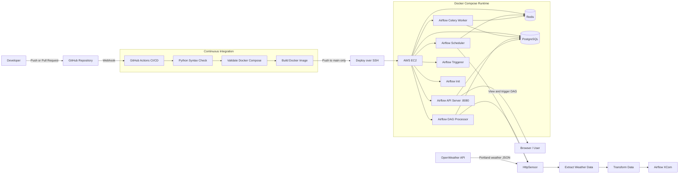

# Airflow OpenWeather Pipeline

Airflow (Docker, CeleryExecutor) DAG that pulls Portland weather from the OpenWeather API. Deployed to AWS EC2 with GitHub Actions.

## Architecture Diagram



## Project Flow

1. Developer pushes code or opens a pull request against `main`.
2. GitHub Actions runs the Python syntax check, validates Docker Compose, and builds the Docker image.
3. For a push to `main`, GitHub Actions connects to the EC2 instance over SSH.
4. EC2 pulls the latest code and runs `docker compose up -d --build`.
5. The `weather_dag` runs every five minutes, checks the OpenWeather API, extracts Portland weather data, and transforms it for downstream processing.

## Airflow Installation (EC2, Amazon Linux)

1. Launch EC2 (t2.xlarge, 32 GB storage). Security group inbound: `22` and `8080` from your IP.
2. Install Docker, Git and Compose:
   ```bash
   sudo dnf update -y
   sudo dnf install -y docker git
   sudo systemctl enable --now docker
   sudo usermod -aG docker $USER && newgrp docker
   sudo mkdir -p /usr/local/lib/docker/cli-plugins
   sudo curl -SL "https://github.com/docker/compose/releases/download/v2.29.7/docker-compose-linux-$(uname -m)" \
     -o /usr/local/lib/docker/cli-plugins/docker-compose
   sudo chmod +x /usr/local/lib/docker/cli-plugins/docker-compose
   ```
3. Clone and configure:
   ```bash
   git clone https://github.com/yousafumer/CI-CD-Project.git
   cd CI-CD-Project
   mkdir -p dags logs plugins config
   cp .env.example .env
   ```
4. Edit `.env`:
   - `FERNET_KEY`: `python3 -c "from cryptography.fernet import Fernet; print(Fernet.generate_key().decode())"`
   - `AIRFLOW_UID`: output of `id -u` (1000 for `ec2-user`)
5. Start Airflow:
   ```bash
   docker compose build
   docker compose up airflow-init
   docker compose up -d
   ```
6. Open `http://<EC2-public-IP>:8080` (default login `airflow` / `airflow`).
7. Add connection `weathermap_api` (Admin > Connections): type `http`, host `https://api.openweathermap.org`.
8. Unpause and trigger `weather_dag`.

## CI/CD (GitHub Actions)

Workflow: `.github/workflows/cicd.yml`

- **Trigger:** push or pull request to `main`.
- **CI job:** Python syntax check, `docker compose config`, `docker compose build`.
- **Deploy job:** runs only on push to `main`, after CI passes. SSH into EC2, then:
  ```bash
  cd ~/Airflow-OpenWeather-Pipeline
  sudo chown -R $(id -u):0 dags logs plugins config
  git pull origin main
  docker compose up -d --build
  ```

### Setup

Add repository secrets (Settings > Secrets and variables > Actions):

| Secret | Value |
|---|---|
| `EC2_HOST` | EC2 public IP or DNS |
| `EC2_USER` | `ec2-user` |
| `EC2_SSH_KEY` | Full contents of the `.pem` file |

Requirements on EC2: repo cloned in `~/Airflow-OpenWeather-Pipeline`, `.env` present, port 22 reachable from GitHub runners.

### Usage

- Edit `dags/weather_dag.py`, then `git push origin main`.
- DAG changes load in Airflow within ~1 minute, no restart needed.
- Dockerfile and compose changes are applied by the deploy job.
